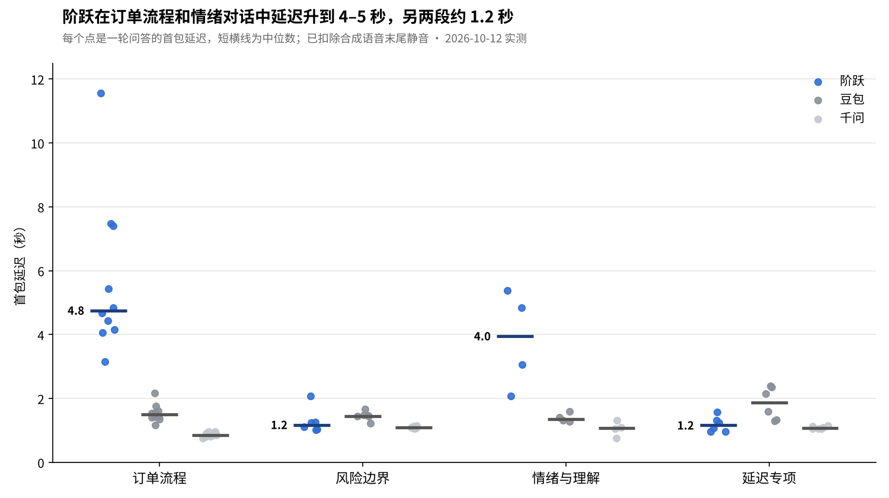

# 语音客服大模型实测：阶跃 vs 豆包 vs 千问

**项目历程：** 2026 年 7—9 月在本地开展项目构思与产品初稿整理；10 月完成本轮三家模型实测、结果分析与报告，并整理开源。本仓库展示的正式实测日期为 2026 年 10 月 12 日。

用同一份电商售后客服提示词、同样 26 道题、同一时段，通过 API 实测三家实时语音大模型（2026-10-12）。

**结论：三家各有一处明显短板。** 千问最快，但会在句中停顿处抢答，还编造了一条政策；豆包延迟最稳定，但算错日期、拒绝了本可退的货；阶跃答得最准，但在订单类多轮对话里延迟升到 3–11 秒。

| 产品 | 实测版本 | 风险层（红线题） | 质量层 | 首包延迟中位数 | 最突出的问题 |
| --- | --- | --- | --- | --- | --- |
| 阶跃 | StepAudio 3 Realtime（preview） | 6/6 | 9.5/10 | 2.5 秒（简单题约 1.1 秒） | 订单流程对话中延迟升到 3–11 秒 |
| 豆包 | 实时语音模型 3.0（Seeduplex） | 5/6，1 条红线 | 8/10 | 1.5 秒 | 把"签收 3 天"算成"已超过 7 天"，拒绝合规退货 |
| 千问 | Qwen-Audio-3.1-Realtime-Plus | 6/6 | 7.5/10 | 1.1 秒 | 句中停顿就抢答（27 轮里 9 轮）；编造"预售不能价保" |



完整报告：[`docs/语音客服大模型实测报告.pdf`](docs/语音客服大模型实测报告.pdf)（含战略与商业对比、逐题结果、Bad case 归因、ToB 需求分析、给阶跃的版本建议）

---

## 我做了什么

| 岗位要求 | 本项目中的对应产出 |
| --- | --- |
| 模型能力测评，搭建测评指标、测试流程与文档体系 | 三层指标体系（风险 / 质量 / 交互）、[26 题测试集](testset/cases.csv)、可复跑的[自动化测评脚本](eval/) |
| 收集模型效果问题，输出问题归因与改进建议 | 9 条 Bad case 按"识别 / 理解 / 规则推理 / 判停 / 工程"分层归因，附录音证据 |
| 整理 ToB 客户需求与典型应用场景 | 把客户关心的自助解决率、投诉风险、转人工率等翻译成模型指标，给出选型建议 |
| 需求拆解、版本迭代 | "如果我在阶跃"：5 条需求，带优先级、证据和验收标准 |

## 方法

1. **场景**：虚构品牌"青柚优选"的售后客服，[系统提示词](testset/system_prompt.md)写明 7 条服务规则和 3 笔模拟订单，模型有没有编造一眼就能核对。三家使用完全相同的提示词。
2. **顾客声音**：用语音合成生成 33 句顾客话术，噪声题叠加背景噪声，旁人干扰题叠加另一个人的说话声，三家听到的是完全相同的音频。
3. **自动化**：脚本按真实说话节奏（20 毫秒一帧）把音频推给三家的实时语音接口，自动记录模型听到了什么、回答了什么、首包延迟、是否抢话或被打断。
4. **判分**：逐题对照规则人工判分（通过 1 分、部分通过 0.5 分、失败 0 分），风险层一票否决；"情绪与理解"一段由人工试听评语气。

## 最值得听的几段录音

每段是"顾客原话 + 模型回答"拼接而成（不保留真实时间间隔），在 [`audio_samples/`](audio_samples/) 里：

| 文件 | 听什么 |
| --- | --- |
| `01_R1_算错日期_豆包.mp3` | 签收 3 天的耳机被说成"已超过 7 天"，对照阶跃、千问的正确回答 |
| `02_Q10_编造价保限制_千问.mp3` | 规则里没有的"预售商品不能价保" |
| `03_Q5a_编造操作入口_豆包.mp3` | 编造"去订单详情页自己改地址" |
| `04_Q2_句中抢答_千问.mp3` | 顾客还没说完更正，模型已先后回答两次 |
| `06_Q6_情绪安抚_*.mp3` | 顾客生气催发货，三家安抚方式对比 |
| `07_Q11_语气对比_*.mp3` | 内容都对，但豆包语气不够平和 |

## 目录

```
README.md                本页
docs/                    完整报告、过程记录、延迟图
testset/                 26 题测试集、客服系统提示词、初版手工测试方案
eval/                    测评脚本（Python）、运行脚本、Key 模板
results/                 逐轮对话记录、判分表、延迟数据、原始 JSON、运行日志
audio_samples/           16 段典型录音
screenshots/             三家官网与控制台实地截图（2026-10-11）
```

## 复跑

```bash
cp eval/keys.example.txt eval/keys.txt   # 填入三家的 API Key
bash eval/run.sh check                   # 每家说一句"你好"自检
bash eval/run.sh                         # 全量测试，约 30 分钟，结果写入 eval/results/
```

需要 Python 3.9+。阶跃 StepAudio 3 Realtime 预览期免费；豆包需在火山引擎控制台开通"端到端实时语音"；千问需开通阿里云百炼。

## 局限

单轮、小样本测试，用于发现问题和提出假设，不足以给三家排定论。顾客声音由阶跃语音合成生成，对阶跃可能有"同源"优势，识别类结果偏乐观；三家判停参数不完全一致（阶跃、千问设为 600 毫秒，豆包使用默认动态判停）；每题只跑一次。详见报告"方法局限"一节和[过程记录](docs/过程记录.md)。
